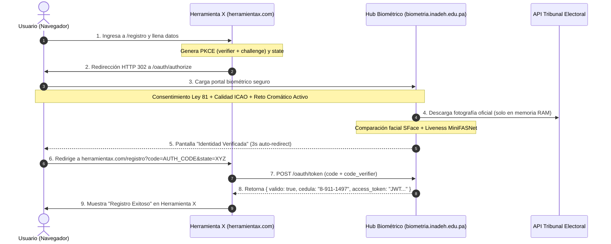

# Guía de Integración para Desarrolladores
## Hub Centralizado de Validación Biométrica (OAuth 2.0 + PKCE)

Esta guía explica cómo integrar cualquier aplicación o herramienta externa (por ejemplo, `herramientax.com/registro`) con el servicio centralizado de validación biométrica del **INADEH / Tribunal Electoral de Panamá**.

---

## 1. Arquitectura y Principio de Privacidad (Ley 81 de 2019)

El Hub Biométrico opera bajo los estándares internacionales **OAuth 2.0 (RFC 6749)** y **PKCE (RFC 7636)** con emisión de aserciones de identidad firmadas en **JWT (RFC 7519)**.

### ¿Por qué redirección y no una llamada API directa con la foto?
1. **Cumplimiento de la Ley 81 de 2019 (Protección de Datos Personales):**
   Los datos biométricos faciales son datos sensibles. Las aplicaciones consumidoras no deben tener acceso al streaming de video crudo de la cámara del ciudadano ni almacenar fotografías de comparación.
2. **Ambiente Seguro de Captura:**
   El Hub ejecuta en el navegador del usuario las validaciones de calidad de captura **ICAO 9303**, pruebas de vitalidad activa con **retos cromáticos criptográficos** y detección de **inyección de cámaras virtuales**.
3. **Resultado Estandarizado:**
   La aplicación consumidora únicamente recibe una credencial criptográfica inviolable que certifica: *«El ciudadano titular de la cédula X completó su prueba de vida y validación facial satisfactoriamente»*.

---

## 2. Diagrama del Flujo de Integración



---

## 3. Requisito Previo: Registro del Cliente en el Hub

Para que el Hub acepte solicitudes de su herramienta, su aplicación debe estar dada de alta con un `client_id`, su tipo (`confidential` o `public`) y las URLs de retorno (`redirect_uris`) autorizadas.

### Configuración en el Hub (`.env`):
El administrador del Hub registra las aplicaciones agregándolas en la variable `OAUTH_CLIENTS_JSON`:

```bash
OAUTH_CLIENTS_JSON='[
  {
    "client_id": "herramienta-x",
    "nombre": "Portal de Registro Herramienta X",
    "tipo": "confidential",
    "client_secret": "clave_privada_super_secreta_del_servidor_999",
    "redirect_uris": [
      "https://herramientax.com/registro",
      "https://herramientax.com/callback",
      "http://localhost:3000/registro"
    ]
  },
  {
    "client_id": "app-movil-spa",
    "nombre": "Aplicación Móvil / SPA (Cliente Público)",
    "tipo": "public",
    "redirect_uris": [
      "https://mi-spa.inadeh.edu.pa/callback"
    ]
  }
]'
```

> [!TIP]
> **¿Cliente Confidencial o Público?**
> * **Cliente Confidencial (`tipo: "confidential"`):** Aplicaciones con servidor/backend (Node.js, Python, Java, PHP, .NET). Requiere obligatoriamente un `client_secret` privado al canjear tokens en `/oauth/token`. **Es la opción recomendada para máxima seguridad.**
> * **Cliente Público (`tipo: "public"`):** Aplicaciones puramente frontend (React, Vue, SPA o apps móviles) que no tienen backend propio para ocultar secretos. Se protegen estrictamente mediante PKCE S256 y lista blanca de `redirect_uris`.

---

## 4. Paso a Paso de la Integración

### Paso 1: Generar parámetros PKCE en su aplicación

Antes de redirigir al usuario, su aplicación genera un secreto criptográfico aleatorio denominado `code_verifier` y calcula su hash SHA-256 codificado en Base64URL (`code_challenge`).

#### Ejemplo en JavaScript (Frontend o Node.js):
```javascript
// Función para codificar en Base64URL (RFC 7636)
function base64UrlEncode(buffer) {
    return btoa(String.fromCharCode(...new Uint8Array(buffer)))
        .replace(/\+/g, '-')
        .replace(/\//g, '_')
        .replace(/=+$/, '');
}

async function generarParametrosPKCE() {
    // 1. Generar code_verifier (32 bytes aleatorios)
    const randomBytes = new Uint8Array(32);
    window.crypto.getRandomValues(randomBytes);
    const code_verifier = base64UrlEncode(randomBytes);

    // 2. Calcular code_challenge = Base64URL(SHA256(code_verifier))
    const encoder = new TextEncoder();
    const data = encoder.encode(code_verifier);
    const digest = await window.crypto.subtle.digest('SHA-256', data);
    const code_challenge = base64UrlEncode(digest);

    // 3. Generar un state único para protección CSRF
    const state = 'st_' + Math.random().toString(36).substring(2, 12);

    return { code_verifier, code_challenge, state };
}
```

---

### Paso 2: Redirigir al usuario al Hub Biométrico

Guarde el `code_verifier` y el `state` en la sesión del usuario (`sessionStorage` o cookie HTTP-only en su backend) y redirija el navegador a la URL de autorización:

```text
GET https://biometria.inadeh.edu.pa/oauth/authorize
    ?response_type=code
    &client_id=herramienta-x
    &redirect_uri=https://herramientax.com/registro
    &code_challenge=CODE_CHALLENGE_GENERADO
    &code_challenge_method=S256
    &state=STATE_GENERADO
    &cedula=8-911-1497
```

#### Parámetros de la URL:
| Parámetro | Requerido | Descripción |
| :--- | :---: | :--- |
| `response_type` | Sí | Debe ser siempre `code`. |
| `client_id` | Sí | El identificador registrado de su herramienta (ej: `herramienta-x`). |
| `redirect_uri` | Sí | URL exacta de su aplicación a donde debe retornar el usuario. |
| `code_challenge` | Sí | Hash Base64URL de su `code_verifier`. |
| `code_challenge_method` | Sí | Debe ser `S256`. |
| `state` | Sí | Valor aleatorio para validar que la respuesta coincida con la petición original. |
| `cedula` | Opcional | Si su formulario ya conoce la cédula del usuario, envíela aquí para precargarla automáticamente. |

#### Código de redirección en JavaScript:
```javascript
async function iniciarValidacionBiometrica(cedulaUsuario) {
    const pkce = await generarParametrosPKCE();

    // Guardar para validar en el retorno
    sessionStorage.setItem('pkce_verifier', pkce.code_verifier);
    sessionStorage.setItem('oauth_state', pkce.state);

    const params = new URLSearchParams({
        response_type: 'code',
        client_id: 'herramienta-x',
        redirect_uri: window.location.origin + '/registro',
        code_challenge: pkce.code_challenge,
        code_challenge_method: 'S256',
        state: pkce.state,
        cedula: cedulaUsuario || ''
    });

    window.location.href = 'https://biometria.inadeh.edu.pa/oauth/authorize?' + params.toString();
}
```

---

### Paso 3: Retorno del usuario a su aplicación

Al culminar satisfactoriamente la verificación facial en el Hub, el sistema muestra la confirmación al usuario y lo redirige automáticamente (en 3 segundos o de inmediato si hace clic) de regreso a su `redirect_uri` con dos parámetros en la URL:

```text
https://herramientax.com/registro?code=AUTH_CODE_EMITIDO&state=STATE_ORIGINAL
```

---

### Paso 4: Canjear el `code` por el resultado y Token JWT

En su página `https://herramientax.com/registro` (o en su backend receptor), extraiga los parámetros `code` y `state` de la URL e intercámbielos mediante una petición POST al endpoint de tokens:

```http
POST /oauth/token HTTP/1.1
Host: biometria.inadeh.edu.pa
Content-Type: application/json

{
    "grant_type": "authorization_code",
    "client_id": "herramienta-x",
    "code": "AUTH_CODE_EMITIDO",
    "redirect_uri": "https://herramientax.com/registro",
    "code_verifier": "CODE_VERIFIER_GUARDADO_EN_EL_PASO_1"
}
```

> [!NOTE]
> Los códigos de autorización tienen un tiempo de expiración de **5 minutos** y son de un solo uso (**Single-Use / Anti-Replay**).

---

### Paso 5: Respuesta con los datos de validación

El endpoint `/oauth/token` retornará un objeto JSON estructurado:

```json
{
  "access_token": "eyJhbGciOiJIUzI1NiIsInR5cCI6IkpXVCJ9.eyJpc3MiOiJodHRwczovL2Jpb21ldHJpYS5pbmFkZWguZWR1LnBhIiwic3ViIjoiOC05MTEtMTQ5NyIsImNlZHVsYSI6IjgtOTExLTE0OTciLCJ2YWxpZG8iOnRydWUsImVzdGFkbyI6IkFQUk9CQURPIiwiaWRfYXVkaXRvcmlhIjoiYjdhZWRjMmYtNTM4My00ODlkLWFjYjItMjU4NmE1YTkzOWEzIiwic2NvcmVfc2ltaWxpdHVkIjowLjQwMTUsImxpdmVuZXNzX3Njb3JlIjowLjkxNDUsIm1ldG9kb19hdXRlbnRpY2FjaW9uIjoiRkFDRV9NQVRDSERfU0ZBQ0UiLCJpYXQiOjE3NDAwMDAwMDAsImV4cCI6MTc0MDAwMzYwMH0.SIGNATURE",
  "token_type": "Bearer",
  "expires_in": 3600,
  "valido": true,
  "estado": "APROBADO",
  "cedula": "8-911-1497",
  "id_auditoria": "b7aedc2f-5383-489d-acb2-2586a5a939a3",
  "score_similitud": 0.4015,
  "liveness_score": 0.9145,
  "timestamp_utc": "2026-10-20T13:10:00Z"
}
```

#### Descripción de Campos Retornados:
- **`valido` (`boolean`)**: `true` si la identidad fue confirmada fehacientemente contra el Tribunal Electoral.
- **`estado` (`string`)**:
  - `APROBADO`: Verificación facial directa con puntaje de similitud alto.
  - `APROBADO_CON_OTP`: Documento con envejecimiento o similitud en zona intermedia, elevado a aprobado tras ingresar código 2FA recibido por SMS/correo.
  - `RECHAZADO`: No superó los umbrales de coincidencia o falló prueba de vida.
  - `REVISION_MANUAL_SOLICITADA`: El ciudadano optó por atención presencial sin usar biometría facial.
- **`cedula` (`string`)**: Cédula panameña validada y formateada.
- **`id_auditoria` (`string`)**: Identificador único global (UUIDv4) para trazabilidad legal y auditoría interna ante cualquier controversia.
- **`access_token` (`string`)**: Token JWT firmado con claims que certifican la validación (estándar RFC 7519).

---

## 5. Ejemplos de Implementación de Referencia

### A. Implementación en Frontend (Vanilla JS / React / Vue)

```javascript
// Ejecutar al cargar herramientax.com/registro
window.addEventListener('DOMContentLoaded', async () => {
    const urlParams = new URLSearchParams(window.location.search);
    const code = urlParams.get('code');
    const state = urlParams.get('state');

    // Si viene regresando del Hub con ?code=
    if (code) {
        const savedState = sessionStorage.getItem('oauth_state');
        const verifier = sessionStorage.getItem('pkce_verifier');

        if (state !== savedState) {
            alert("Error de seguridad: el parámetro state no coincide.");
            return;
        }

        try {
            const resp = await fetch('https://biometria.inadeh.edu.pa/oauth/token', {
                method: 'POST',
                headers: { 'Content-Type': 'application/json' },
                body: JSON.stringify({
                    grant_type: 'authorization_code',
                    client_id: 'herramienta-x',
                    code: code,
                    redirect_uri: window.location.origin + '/registro',
                    code_verifier: verifier
                })
            });

            const data = await resp.json();

            if (data.valido === true) {
                console.log("Cédula validada con éxito:", data.cedula);
                document.getElementById('inputCedula').value = data.cedula;
                document.getElementById('estadoValidacion').innerHTML = 
                    `<span class="badge-verde">Identidad Verificada (ID Auditoría: ${data.id_auditoria})</span>`;
                // Desbloquear botón de completar registro
                document.getElementById('btnCompletarRegistro').disabled = false;
            } else {
                alert("La validación biométrica no fue aprobada: " + data.estado);
            }
        } catch (err) {
            console.error("Error al canjear código:", err);
        } finally {
            // Limpiar sesión
            sessionStorage.removeItem('pkce_verifier');
            sessionStorage.removeItem('oauth_state');
        }
    }
});
```

---

### B. Implementación en Backend Node.js (Express)

```javascript
const express = require('express');
const axios = require('axios');
const app = express();

app.get('/registro', async (req, res) => {
    const { code, state } = req.query;

    if (!code) {
        // Mostrar formulario inicial con botón de iniciar validación biométrica
        return res.render('registro_formulario');
    }

    // El usuario acaba de retornar del Hub con el código
    const verifier = req.session.code_verifier; // Recuperado de la sesión del servidor

    try {
        const tokenResponse = await axios.post('https://biometria.inadeh.edu.pa/oauth/token', {
            grant_type: 'authorization_code',
            client_id: 'herramienta-x',
            code: code,
            redirect_uri: 'https://herramientax.com/registro',
            code_verifier: verifier
        });

        const resultado = tokenResponse.data;

        if (resultado.valido) {
            // Guardar en la base de datos de Herramienta X
            await db.usuarios.actualizarEstadoBiometrico({
                cedula: resultado.cedula,
                verificado: true,
                idAuditoria: resultado.id_auditoria,
                tokenJwt: resultado.access_token
            });

            return res.render('registro_completado', { usuario: resultado });
        } else {
            return res.render('registro_rechazado', { motivo: resultado.estado });
        }
    } catch (error) {
        console.error("Error en validación OAuth:", error.response?.data || error.message);
        return res.status(500).send("Error al verificar identidad biométrica.");
    }
});
```

---

### C. Implementación en Python (FastAPI / Requests)

```python
import httpx
from fastapi import FastAPI, Request
from fastapi.responses import HTMLResponse

app = FastAPI()

HUB_URL = "https://biometria.inadeh.edu.pa"

@app.get("/registro")
async def callback_registro(code: str = None, state: str = None):
    if not code:
        return HTMLResponse("<h1>Bienvenido al registro. Haga clic en Validar Identidad.</h1>")

    # Canje server-to-server con PKCE
    async with httpx.AsyncClient() as client:
        resp = await client.post(
            f"{HUB_URL}/oauth/token",
            json={
                "grant_type": "authorization_code",
                "client_id": "herramienta-x",
                "code": code,
                "redirect_uri": "https://herramientax.com/registro",
                "code_verifier": "MI_CODE_VERIFIER_ALMACENADO"
            }
        )
        datos = resp.json()

    if datos.get("valido") is True:
        return {
            "mensaje": "Registro completado con éxito",
            "cedula": datos["cedula"],
            "id_auditoria": datos["id_auditoria"],
            "metodo": datos.get("metodo_autenticacion", "BIOMETRICO")
        }
    else:
        return {"error": "Validación no completada", "detalle": datos.get("estado")}
```

---

## 6. Verificación de Tokens JWT (Backend a Backend)

Si su backend recibe el `access_token` JWT y desea validarlo sin consultar a una base de datos externa, puede decodificarlo o inspeccionarlo en el endpoint estándar RFC 7662:

```http
POST /oauth/introspect HTTP/1.1
Host: biometria.inadeh.edu.pa
Content-Type: application/json

{
    "token": "eyJhbGciOiJIUzI1NiIsInR5cCI6IkpXVCJ9..."
}
```

Respuesta si el token es legítimo y no ha expirado:
```json
{
  "active": true,
  "scope": "biometria",
  "client_id": "herramienta-x",
  "sub": "8-911-1497",
  "exp": 1740003600,
  "valido": true,
  "estado": "APROBADO",
  "id_auditoria": "b7aedc2f-5383-489d-acb2-2586a5a939a3"
}
```

---

## 7. Preguntas Frecuentes y Soporte

1. **¿Qué sucede si el usuario rechaza dar su consentimiento biométrico?**
   En apego a la Ley 81, el usuario tiene la opción de seleccionar *"Solicitar revisión presencial"*. En ese caso, el Hub lo redirige a su `redirect_uri` con un código cuyo estado será `REVISION_MANUAL_SOLICITADA` y `valido: false`, permitiéndole a su herramienta indicarle dónde presentar sus documentos físicos.

2. **¿Puede el usuario manipular el resultado en el navegador?**
   **No.** El flujo con PKCE evita ataques de intermediación (MitM) y manipulación en el cliente. La confirmación final proviene exclusivamente del canje seguro del Authorization Code contra el servidor del Hub mediante verificación criptográfica SHA-256.

3. **¿Cómo probar la integración localmente?**
   Puede usar el simulador de cliente incluido en el proyecto navegando a:
   `http://localhost:8000/demo/cliente`
   Este simulador demuestra en tiempo real la generación de PKCE, la redirección, la validación y el canje de tokens.

---

---

## 8. Seguridad y Mejores Prácticas: MitM y Control de Apps Autorizadas

### 8.1 ¿Cualquier persona "Man-in-the-Middle" (MitM) puede hacer requests a este servicio?

**No. La arquitectura está blindada en dos niveles: a nivel de transporte (TLS) y a nivel criptográfico de aplicación (PKCE).**

#### A. A nivel de red (Tráfico interceptado)
* **Cifrado obligatorio (HTTPS / TLS):** Todo el tráfico entre el navegador del usuario, el Hub y el Tribunal Electoral viaja encriptado. Un atacante en la misma red Wi-Fi pública, ISP o router intermedio **solo ve paquetes cifrados**; no puede ver las imágenes, el video, los datos ni inyectar peticiones.

#### B. ¿Qué pasa si el atacante logra interceptar la URL con el código (`?code=XYZ`)?
Aquí es donde **PKCE (RFC 7636)** hace su trabajo:
1. Cuando la Herramienta X inicia el flujo, genera un secreto en su memoria: `code_verifier`.
2. A la red pública solo envía el hash matemático SHA-256: `code_challenge`.
3. Al terminar la biometría, el Hub redirige al usuario con un `code` temporal (5 minutos de vida).
4. **Si un atacante MitM intercepta ese `code` en el navegador o en la red, NO PUEDE USARLO:**
   * Para canjear el `code` por el token final en `/oauth/token`, el atacante está obligado a enviar el `code_verifier` original en texto plano.
   * Como el `code_verifier` nunca viajó en la URL ni por la red durante la redirección, el atacante no lo tiene.
   * Al intentar canjearlo con cualquier otro valor, el Hub calcula el hash, comprueba que no coincide y **aborta con HTTP 400: Verificación PKCE fallida**.
5. **Anti-Replay:** Cada código de autorización se elimina de memoria RAM en el primer intento de canje (un solo uso).

---

### 8.2 ¿Cómo nos aseguramos de que SOLO apps autorizadas puedan utilizar el servicio?

Para impedir que cualquier aplicación pirata o tercero no autorizado use el Hub, se aplican **4 capas de control**:

#### Capa 1: Lista Blanca Estricta de `redirect_uri` *(Ya activa)*
* Aunque un atacante conozca tu `client_id` (ej. `"herramienta-x"`), **el Hub únicamente redirige a los dominios exactos dados de alta en la lista blanca** (`https://herramientax.com/registro`).
* Si el atacante intenta enviar `redirect_uri=https://sitio-pirata.com`, el Hub rechaza la petición de inmediato con `HTTP 400: URI de redirección no autorizada`.
* **Resultado:** El atacante nunca puede hacer que el Hub le envíe el código de autorización a sus propios servidores.

#### Capa 2: Clientes Confidenciales con `client_secret` en el Backend *(Recomendado para apps con servidor)*
Si la Herramienta X tiene un backend propio (Node.js, Python, Java, PHP, C#/.NET):
1. **El navegador NUNCA debe llamar a `/oauth/token`:** El navegador solo recibe el `?code=` en la URL y se lo transfiere internamente a su backend.
2. **Exigencia de `client_secret` privado:** El backend de la Herramienta X es quien hace la llamada servidor-a-servidor a `/oauth/token` enviando su `client_secret` (clave que ningún usuario ni atacante puede ver en DevTools).
3. **Configuración en el Hub:** Registramos a la Herramienta X como cliente confidencial en `OAUTH_CLIENTS_JSON`:
   ```json
   {
     "client_id": "herramienta-x",
     "nombre": "Herramienta X",
     "tipo": "confidential",
     "client_secret": "clave_privada_super_secreta_del_servidor_999",
     "redirect_uris": ["https://herramientax.com/registro"]
   }
   ```
4. **Resultado:** Si cualquier persona externa o aplicación no autorizada intenta llamar a `/oauth/token` sin esa clave privada exacta, el Hub la **bloquea inmediatamente con HTTP 401 Unauthorized**.

#### Capa 3: Anti-Clickjacking y Aislamiento de Cámara *(Protección en Navegador)*
Implementado nativamente en el servidor mediante cabeceras HTTP de seguridad:
* **`X-Frame-Options: DENY`** y **`Content-Security-Policy: frame-ancestors 'none'`:** Impide que cualquier sitio web malicioso incruste la pantalla biométrica en un `<iframe>` oculto para engañar al usuario haciéndole creer que está en otra página (Clickjacking).
* **`Permissions-Policy: camera=(self)`:** Garantiza que únicamente el dominio del Hub puede activar la cámara web.

#### Capa 4: Restricción por Firewall / Whitelist de IPs *(Para Infraestructura Crítica)*
En un entorno de producción gubernamental o bancario:
* El Reverse Proxy (Nginx, Cloudflare o AWS WAF) que está frente al Hub Biométrico puede configurarse con una **regla de lista blanca de IPs**:
  * Las rutas de interfaz (`/oauth/authorize`, `/api/verificar`) están abiertas a los ciudadanos.
  * El endpoint de canje de tokens (`POST /oauth/token`) **solo acepta peticiones provenientes de las direcciones IP públicas de los servidores autorizados de Herramienta X**.
  * Cualquier petición a `/oauth/token` desde otra IP es descartada a nivel de firewall antes de tocar el servidor.

---

### 8.3 Resumen de Recomendaciones de Integración

| Tipo de Aplicación | Nivel de Seguridad | Mecanismo Recomendado |
| :--- | :---: | :--- |
| **App con Backend** *(Node.js, Python, Java, PHP, .NET)* | **Máximo (Bancario / Estatal)** | Registrar como `tipo: "confidential"`. El canje de `/oauth/token` se realiza estrictamente backend-a-backend con `client_secret` + `code_verifier`. Opcional: Whitelist de IPs en Firewall. |
| **App Frontend / SPA** *(React, Vue, Angular, Móvil)* | **Estándar OAuth2 (RFC 7636)** | Registrar como `tipo: "public"`. `redirect_uri` estricto en whitelist + PKCE `S256` forzoso + CORS restringido exclusivamente a su dominio. |

